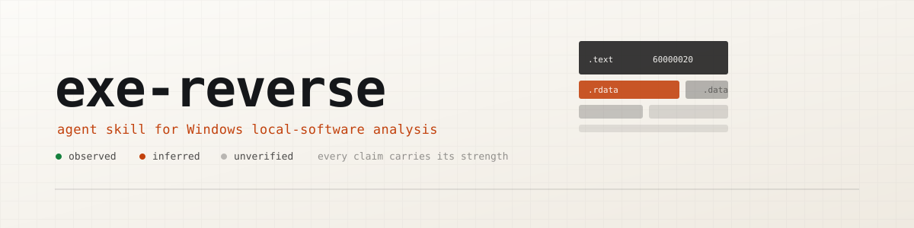

<p align="center">
  <picture>
    <source media="(prefers-color-scheme: dark)" srcset="assets/banner-dark.svg">
    
  </picture>
</p>

<p align="center">
  <b>English</b> · <a href="README.zh-CN.md">简体中文</a>
</p>

<p align="center">
  <a href="LICENSE"></a>
  
  
  
</p>

<p align="center">
  <a href="#what-it-is-good-at">Capabilities</a> · <a href="#structure">Structure</a> · <a href="#install">Install</a> · <a href="#requirements">Requirements</a> · <a href="#read-this-first">Failure catalogue</a> · <a href="#scope">Scope</a> · <a href="#repository-maintenance">Maintenance</a>
</p>

# exe-reverse

An Agent Skill for Windows x86/x64 **local-software** reverse engineering: triage, byte-level
patching, signature work, debugging, injection, dump repair, licensing-mechanism classification,
algorithm recovery, packers and code virtualisation, managed assemblies, kernel drivers, and the
**hardware-observation layer** — instruction tracing, hardware breakpoints, and hypervisor-assisted
observation — that software tooling cannot substitute for.

It is a **skill**, not a tutorial: it is written to be loaded by an agent while it works, so it is
organised for progressive disclosure — a short decision-oriented `skills/exe-reverse/SKILL.md`,
detailed references loaded only when a step needs them, and parameterised scripts you can run
directly.

## How an agent is expected to consume this

`SKILL.md` is written as a **procedure with gates**, not as advice, because the observed failure mode
is not ignorance — it is a model reading the whole thing, agreeing with it, and then reasoning from
first principles anyway.

Four things in it are meant to be *acted on*:

- **Five operating rules (O1–O5).** Where they conflict with the current plan, they win until
  evidence overrides them.
- **A symptom index.** Each row is a failure that has already been paid for. A matching row is a
  **stop signal**: load that file before running another command, not after a few more attempts.
- **Five gates (G1–G5),** each an action with a pass criterion. "I understand the idea" does not
  clear a gate. They exist so that classification, host truth and a control build happen *before* the
  first patch, not after the third failure.
- **A two-strike rule and stop conditions.** Two failures of the same shape mean the model is wrong,
  not the parameters.

And one thing at the end that is meant to be *withheld*: **"done" has a definition (six items).** A
clean log is not one of them. Anything short of all six is a checkpoint, and should be reported as a
checkpoint with what remains.

The cheapest possible first command is `python skills/exe-reverse/scripts/doctor.py`. It answers
three questions in one pass: which capabilities this host actually supports and what to install for
the ones it does not, whether every script in the kit is runnable as-is, and which host facts would
silently poison an experiment. `python skills/exe-reverse/scripts/hwprobe.py` is the deeper
hardware-level probe beneath it, and `python skills/exe-reverse/scripts/capabilities.py --verbose`
prints the next action for anything blocked.

## What it is good at

- Deciding **fast** whether a request is achievable by changing the client at all, instead of burning
  hours on a decision the server owns.
- Establishing **which host you actually have** before a plan depends on it: a debugger installed, an
  elevated session, test signing, a second machine, or a hypervisor that intercepts the very
  mechanism the plan relies on.
- Patching **without breaking the file**: equal-length edits first, the checksum recomputed, the
  written bytes re-read from disk, and a length change reported as the structural edit it is.
- Making a signature **honest about itself**: how many sites a pattern matched, whether that count
  changed between builds, and whether the pattern is a locator or a coin flip.
- Separating **"the bytes are in the file" from "the code runs"** — the most common way a patch is
  reported as working while nothing changed.
- Classifying a **licence decision** before touching it: client-verified, client-rendered server data,
  or server-authoritative — three problems with three different answers, only two of which a binary
  change can reach.
- Working through **a target that fights analysis**: recognising which anti-analysis mechanism
  actually fired, and which layer can still observe the target when every hook is detected.
- Reaching for the **hardware layer** when a debugger cannot: hardware breakpoints that do not modify
  the bytes they watch, instruction tracing that records control flow without executing hooks, and
  an honest statement of what each of those requires and what it still cannot see.
- Keeping a **long session honest**: a live record, graded conclusions, bounded waits calibrated from
  a measurement, and a control build for every claim.
- **Publishing what it learns without publishing the target** — a scanner that reports identity
  shapes with their context, and an explicit list of what must *not* be redacted because redacting it
  destroys the reusable part.

## Structure

`SKILL.md`, `references/` and `scripts/` live inside the skill directory, `skills/exe-reverse/`.
Everything at the repository root is maintenance tooling shared across skills, not part of an
installed skill.

```
skills/exe-reverse/SKILL.md     a procedure with gates, not background reading:
                                five moves -> five override rules (O1-O5)
                                symptom index (a matching row is a stop signal)
                                five gates (G1-G5, actions with pass criteria)
                                thirteen classification questions
                                target routing table
                                the tool/context budget rules
                                the workflow -> what "done" means -> stop conditions -> constraints
skills/exe-reverse/references/  loaded on demand, one topic each; the inventory with when to load
                                each one is skills/exe-reverse/references/routing.md
skills/exe-reverse/scripts/     parameterised and path-agnostic; runnable on a bare Python 3.10+
skills/exe-reverse/evals/       the with-skill / without-skill cases, and how to run them
skills/exe-reverse/evidence/    the machine-readable companions to the evidence summary
docs/tool-verification/         the evidence record for measurement passes (not shipped)
tests/                          the executable regression suite
```

The reference library is indexed, not memorised: `skills/exe-reverse/references/routing.md` carries
every reference file with when to load it and every script with what it does, and it is the file to
read once a route has been chosen.

## Install

This repository is a **skills repository**: the skill lives at `skills/exe-reverse/`, which is the
layout the `skills` CLI resolves, and it is installed by name rather than by copying a directory:

```
npx skills add <owner>/exe-reverse                 # install every skill in the repo
npx skills add <owner>/exe-reverse --list          # list what is here, install nothing
npx skills add <owner>/exe-reverse --skill exe-reverse -y
npx skills use  <owner>/exe-reverse@exe-reverse    # use it once, without installing
```

The CLI symlinks the skill into your agent's skills directory by default (`--copy` makes independent
copies instead), `-g` installs for every project rather than the current one, and `-a` targets
specific agents. With one skill in the repository, `--skill exe-reverse` is redundant today; it is
written out because it is what selects a single skill once a second one exists.

Once installed, the agent loads `SKILL.md` when a task matches its description and pulls in
`references/*` only as needed. No global state, no machine-specific paths, and no build step.

## Requirements

Nothing is mandatory; each script checks what it needs, and `skills/exe-reverse/scripts/hwprobe.py`
reports which of these are present here and which routes are therefore available — including the
routes that are *not* available on a virtualised host.

If your toolchain lives outside `PATH` (a project-local tools directory, a versioned SDK folder),
set `EXEREV_TOOLS` to one or more directories and the probes will find them:

```
set EXEREV_TOOLS=<dir>;<dir>                     # Windows
export EXEREV_TOOLS=<dir>:<dir>                  # POSIX
```

| Tool | Used for |
|---|---|
| Python 3.10+ | every script; the PE reader, patcher, host probe, capability registry and doctor are dependency-free |
| A disassembler/decompiler (IDA, Ghidra, Binary Ninja, Cutter) | reading code; several are GUI-only, and a GUI-only tool is a request for a human, not a reason to substitute a weaker one |
| A debugger (x64dbg, WinDbg) | locating runtime behaviour and watching values |
| `dumpbin` / `link` (MSVC toolchain) | header and import inspection when you have the SDK |
| An installer extractor (`innoextract`, 7-Zip, `expand`) | getting at a payload without running the installer. Extract first and re-triage what came out: it is a new unknown |
| Frida | runtime instrumentation where a hook is acceptable |
| Procmon / ETW tooling (`wpr`, `logman`) | file, registry and system event evidence |
| A .NET toolchain | managed assemblies are a different artifact with a different toolchain |
| A solver or emulator (Z3, Triton, angr, Unicorn, Qiling) | reducing a trace or a condition instead of reading it; `skills/exe-reverse/references/symbolic-execution.md` records which default of each will change your answer |
| An isolated VM | the analysis host is part of the experiment |
| A second machine | kernel debugging on a current Windows host |
| A CPU that reports the trace feature, plus a capture path | the hardware-observation routes; the probe reports what this host has, and on this platform the capture path is the open question rather than the decoding |

None of these need to be on `PATH`: the scripts accept explicit paths for the tools they shell out
to, and a runnable archive or a script counts as installed.
`skills/exe-reverse/scripts/capabilities.py` carries the
same list as a probed registry, with an executable next step and a cost estimate for each entry.
`ls skills/exe-reverse/scripts/` is the authoritative list; `skills/exe-reverse/references/routing.md`
describes each one.

## Read this first

**Published for learning, research and authorized security testing only.** It ships no exploit
payloads, no target data and no third-party binaries — it is a method, a set of scripts and an
evidence record.

Then read `skills/exe-reverse/references/pitfalls.md`. It is the most valuable file here — every
entry is a failure that produced a working-looking artifact. Read it before building.

## Scope

Built for working on your own software, samples you are authorized to analyse, and competition
sandboxes. It contains no vendored third-party binaries and no target-specific data.

What it covers, and what it deliberately does not, is stated in the skill itself
(`skills/exe-reverse/references/coverage-and-limits.md`). The short version: Windows PE on x86 and
x64, deep on the layers that have been worked through — triage, patching, signatures, licensing
classification, protectors, managed code, and the hardware-observation route map. Defeating a
server-side authority, a fully automated general-purpose devirtualiser, defeating a named commercial
protector as a product claim, and any guarantee on a Windows build this repository has not measured
are **not** covered, and the skill is written to say so and stop rather than apply the nearest
documented procedure to a target it was not written for.

## Repository maintenance

Six tools live at the root and are not part of the installed skill:

```
check_repo.py      every skill discovered, frontmatter valid, scripts runnable, documented paths
                   resolve, README paths explicit and existing, and -- on the tracked surface only
                   -- no target identity (delegates the rules to scan_leaks.py)
check_refs.py      every cross-reference that names a section of another document reaches a real
                   heading in that document
check_routing.py   the on-demand inventory still matches the entry point: the symptom mirror agrees
                   with SKILL.md, and every reference file and every script is named in routing.md
check_commands.py  every command a document tells you to run is checked against the script's own
                   argparse table -- a documented flag that does not exist is drift the anchor
                   checks cannot see
check_budget.py    keep the always-loaded part from creeping: SKILL.md measured in lines and
                   tokens, index-row length, long files with no navigable head, hedged rules
build_scripts.py   audit for machine-specific leftovers (absolute paths, credentials)
```

Consistency has a natural counter-pressure — a broken path fails loudly and someone fixes it. Bloat
has none, which is why the budget gate exists.

`tests/benchmark.md` holds the regression matrix: dimension → public target → the scripts the row
exercises → measured result → strength label. `docs/tool-verification/` is the evidence record for
the measurement passes: what each script actually did, which independent method confirmed it, and
which scenarios the target could not exercise. It exists so the coverage claims can be checked
against runs instead of trusted.

---

## Disclaimer

**For learning, research and authorized security testing only.** Every script, reference and
recorded result in this repository exists to explain *how* Windows application analysis works, so
that practitioners can reason about the tools they already own. Nothing here is a service, a
product, or an endorsement of any particular use.

The material is provided *as is*, without warranty of any kind. Results are recorded as they were
measured on one machine at one time; nothing here promises that a route will work on your target,
your host or your toolchain. Verify before you trust, and work on copies.

Names of tools, libraries, file formats and hardening products appear only to make the material
reusable; they belong to their respective owners, and this project is not affiliated with any of them.
